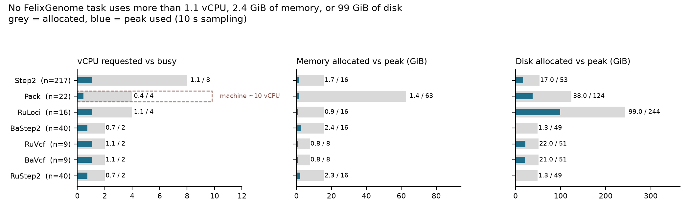

# FelixGenome resource review

Run `gs://fc-secure-8f7d6a20-04ce-40d7-8c88-aececeac3e09/submissions/706a9135-df50-4b26-a6a9-22afe2503102/FelixGenome/e4084ae2-7527-4d55-a8f1-a2896d5f2bcd`
(22 chromosomes x 10 phenotypes, three arms). 355 `monitoring.log` traces, collected with
`scripts/collect_terra_monitoring_logs.sh` and summarized with `scripts/summarize_terra_monitoring.py`.



## Headline

Every task in the workflow is **effectively single-threaded**: mean busy cores run
from 0.44 (Pack) to 1.11 (RuLoci) against requests of 2 to 8 vCPU, and no task touches
more than 2.4 GiB of memory. The
run held 421 VM-hours and ~2,985 vCPU-hours, of which **432 vCPU-hours did any work**
— 86% of the CPU we paid for was idle. Estimated list-price cost $136 for this
10-phenotype run; at the settings applied below, the same work is ~$27.

At the planned 943-phenotype scale the per-phenotype tasks multiply by 94x: roughly
30,000 VM-hours and **~$9,800 as configured, ~$1,890 at the applied settings**.

## How we know the core count

The monitoring header reports `#CPU: 1` on every VM in this run, which is wrong — the
memory and disk headers match the WDL requests exactly (16 GB -> 15.62 GiB visible,
64 -> 62.80, 8 -> 7.76), so the CPU line is the odd one out. The CPU percentage is
normalized to the whole machine, which lets the steady-state value recover the real
machine size: a single pinned thread reads `100/N %`.

| task | steady CPU | implied vCPU | requested `cpu` |
|---|---|---|---|
| Step2 | 12.60% | 7.9 | 8 |
| RuLoci | 25.44% | 3.9 | 4 |
| RuVcf / BaVcf | 50.83% | 2.0 | 2 |
| Pack | 10.17% | 9.8 | 4 |

Three of four recover the request exactly, which validates the method. **Pack is the
exception**: it asks for 4 vCPU but runs on a ~10-vCPU machine, because GCE custom
machine types cap at ~6.5 GB per vCPU and `pack_memory_gb = 64` forces at least 10
cores. Pack is billed for 10 cores and uses 0.44 of one.

## Per-task measurements

Wall times below cover the task command only: at the first monitoring sample the
inputs are already on disk, so localization and delocalization are outside the trace
and billed VM time is somewhat longer than shown.

| task | n | wall median / max (min) | vCPU busy / billed | mem peak / alloc (GiB) | disk peak / alloc (GiB) |
|---|---|---|---|---|---|
| Step2 | 217 | 82 / 173 | 1.08 / 8 | 1.7 / 15.6 | 17 / 53 |
| Pack | 22 | 83 / 153 | 0.44 / 10 | 1.4 / 62.8 | 38 / 124 |
| RuLoci | 16 | 162 / 342 | 1.09 / 4 | 0.9 / 15.6 | 99 / 244 |
| RuVcf | 9 | 83 / 106 | 1.10 / 2 | 0.8 / 7.8 | 22 / 51 |
| BaVcf | 9 | 79 / 107 | 1.10 / 2 | 0.8 / 7.8 | 21 / 51 |
| RuStep2 | 40 | 13 / 17 | 0.74 / 2 | 2.3 / 15.6 | 1.3 / 49 |
| BaStep2 | 40 | 14 / 18 | 0.73 / 2 | 2.4 / 15.6 | 1.3 / 49 |

`Check` and `CheckNulls` finished inside one 10 s sampling interval and have no runtime
samples; both already run at 1 vCPU / 1-2 GB and need no change.

## Applied settings (2026-10-12)

Peak memory across all 355 executions is 2.39 GiB. Every right-sized task gets
`cpu = 1, memory_gb = 6`: 2.5x headroom over the worst observed peak, and the largest
memory that still fits a 1-vCPU machine. **That second constraint is the one to
remember** — a GCE custom machine type carries at most ~6.5 GB per vCPU, so
`memory_gb` above `6.5 x cpu` silently widens the machine and bills the extra cores.
That is exactly what `pack_memory_gb = 64` was doing.

| task (WDL) | cpu | memory_gb | preemptible |
|---|---|---|---|
| `RunFelixStep2` (Step2) | 8 -> **1** | 16 -> **6** | 1 (unchanged) |
| `PackFelixla` (Pack) | 4 -> **1** | 16 -> **6** | 0 (unchanged) |
| `AggregateRepeatLoci` (RuLoci) | 4 -> **1** | 16 -> **6** | 1 -> **0** |
| `WriteRuAdmixedVcf` (RuVcf/BaVcf) | 2 -> **1** | 8 -> **6** | 1 -> **0** |
| `RunFelixStep2RuVcf` (RuStep2/BaStep2) | 2 -> **1** | 16 -> **6** | 1 -> **3** |
| `CheckNullArrays` | 1 | 2 | 1 -> **3** |

Workflow defaults `pack_cpu` and `pack_memory_gb` moved to 1 and 6 to match, and the
stale Terra overrides were updated with them: `configs/terra/FelixGenomeTable.inputs.json`
carried both `pack_cpu` = 4 and `pack_memory_gb` = 64, and
`configs/terra/FelixGenomeLimited.inputs.json` carried `pack_memory_gb` = 64 only. A
stale override in the method config would have defeated the WDL change.

**Disk was deliberately left alone.** It is over-allocated (RuLoci holds 244 GiB to
peak at 99) but disk is 7% of the bill: cutting every disk to 1.5x its peak would have
saved $1.28 on this run. Against that, these are `HDD` (pd-standard) volumes whose
throughput scales with provisioned size, and RuLoci reads at a sustained 17 MiB/s
through the first 80 minutes of its 2.7-5.7 h run (dropping to 5-6 MiB/s for the
remainder) — shrinking it risks trading hours of wall clock for a dollar.

### Why these preemptible settings

Preemptibility should follow **restart cost**, not task size. A preempted task restarts
from zero, so the question is what a restart costs in wall clock and whether anything
is waiting on it.

- **Long and on the critical path -> `0`.** RuLoci runs 2.7-5.7 h and feeds
  RuVcf -> RuStep2; RuVcf/BaVcf run 1.3-1.8 h. A preemption four hours into RuLoci
  costs four hours and delays everything behind it. These also showed the highest
  retry rates in this run (4 of 9 BaVcf, 3 of 9 RuVcf, 2 of 16 RuLoci had an
  `attempt-2`), which is what tipped them to on-demand. Pack (1.4-2.5 h, feeds Step2)
  was already 0 and stays there.
- **Short and massively parallel -> `3`.** RuStep2/BaStep2 run 13-14 min; three spot
  attempts cost at most ~45 min of retry and nothing downstream is waiting on any
  single shard. Same logic for the trivial `CheckNullArrays`.
- **Medium, parallel, with an on-demand backstop -> `1` (unchanged).** Step2's 82-minute
  median and 3% observed preemption rate (7 of 217) means one spot attempt then
  on-demand bounds the worst case at ~2.7 h per shard while keeping the cheap rate on
  97% of 20,746 shards at full scale. Raising it to 2 would save a little more and add
  ~1.4 h to the makespan tail; not worth it when the run has to finish overnight.
- **Gating the whole workflow -> `0` (unchanged).** MakeGRM and the per-phenotype
  FitFelixNull tasks are upstream of every scatter; nothing else can start until
  CheckNulls passes. They are also call-cached across runs, so they usually cost
  nothing anyway.

Cromwell's call-cache key covers the command, inputs and docker image — not
`cpu`/`memory`/`disks`/`preemptible` — so these edits do not invalidate cached calls
from the previous run.

## Beyond right-sizing

1. **Step2 is the whole workflow.** 301 of the 421 VM-hours, and 28,400 VM-hours at
   943 phenotypes. It is single-threaded for its entire 82-minute median, with a 5.6x
   spread across chromosomes (27 min to 155 min median by chromosome), so the critical
   path is set by the largest chromosome. Splitting the largest chromosomes by region,
   or testing several phenotypes inside one Step2 invocation, would both help; the
   second also amortizes the packed-tar localization that currently repeats per
   phenotype.
2. **RuLoci runs 5.7 hours on one core** for the largest chromosome, reading 180 GiB.
   At one thread and ~17 MiB/s this is the longest single task in the workflow.
3. **Preemption retries.** `attempt-2` directories exist for 7 Step2, 4 BaVcf, 3 RuVcf,
   2 RuLoci and 2 RuStep2 executions. Tasks running 80+ minutes at `preemptible = 1`
   are exposed; for the 80-minute VCF-writing tasks a retry roughly doubles their cost.
   Worth either raising `preemptible` to 2-3 or shortening the tasks.

## Planning an overnight run

Two separate limits decide what finishes by morning.

**The critical path is at least ~5.5 h and does not shrink with phenotype count.** The
main arm is fully measured on all 22 chromosomes and tops out at **5.4 h** (chromosome
scatter index 11: Pack 2.5 h then Step2 2.9 h). The RU arm cannot be measured end to
end here, because the logs were collected while the run was still in flight: only 4
chromosomes have RuLoci, RuVcf and RuStep2 all captured, and the longest of those
complete chains is 3.9 h. The chromosome with the longest RuLoci (5.7 h, index 15) has
no RuVcf or RuStep2 trace yet, so its chain is **>= 5.7 h by an unmeasured margin** —
treat 5.5-6 h as the floor and re-measure on a run that completes. On top of either
arm, nothing starts until MakeGRM and the per-phenotype FitFelixNull fits clear
CheckNulls, and Concat/Summarize run after everything.

**Throughput then sets the phenotype count.** Step2 is 22 shards per phenotype at an
82-minute median, so a 10-hour window with C concurrently running VMs clears roughly
`0.33 x C` phenotypes: ~67 at 200 concurrent, ~167 at 500, ~334 at 1000. Check the
workspace's actual concurrent-VM and CPU quota before choosing. Batching a few
hundred phenotypes per submission, rather than one 943-phenotype workflow, also keeps
the Cromwell call count manageable.

## Reproducing

```bash
./scripts/collect_terra_monitoring_logs.sh gs://<workspace-bucket>/submissions/<sid>/FelixGenome/<wid>
./scripts/summarize_terra_monitoring.py terra_monitoring.tar.gz --outdir monitoring_report
```

Cost figures are GCE us-central1 N1 custom list prices ($0.033174/vCPU-hr,
$0.004446/GiB-hr, PD-standard disk) applied to measured wall time; tasks with
`preemptible > 0` bill lower on early attempts, so treat them as an upper bound and a
relative ranking rather than an invoice.
